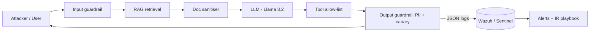

<!-- ============================  HEADER  ============================ -->
<p align="center">
  
</p>

<p align="center">
  
</p>

<p align="center">
  
  
  
  
  
</p>

<p align="center">
  
</p>

<p align="center">
  <a href="https://www.linkedin.com/in/YOUR-LINKEDIN-SLUG/"></a>
  <a href="mailto:oja2001pat@gmail.com"></a>
  <a href="https://tryhackme.com/p/ojaspatil10"></a>
  
</p>

---

## 👋 About Me

I'm a **Security Operations Analyst** with hands-on enterprise SOC experience at **Reliance Jio** and **Sequretek**, and an **MSc in Cyber Security** from the National College of Ireland.

I triage, investigate and respond to threats across SIEM, EDR and network telemetry — and I spend my lab time **building and tuning the detections** that make that work faster. Lately I've been applying SOC thinking to a new attack surface: **LLM applications** — attacking them, putting guardrails around them, and streaming their activity into a SIEM.

```yaml
whoami:
  role:        Security Operations / SOC Analyst
  focus:       [Alert Triage, Incident Response, Threat Hunting, Detection Engineering, AI Security]
  siem:        [Microsoft Sentinel, Wazuh, Splunk, IBM QRadar (basic)]
  edr_xdr:     [SentinelOne, Trend Micro Vision One, Microsoft Defender]
  query:       [KQL, SPL, SQL]
  automation:  [Python, PowerShell, Bash]
  frameworks:  [MITRE ATT&CK, MITRE ATLAS, OWASP Top 10 for LLMs]
  certs:       [CEH v12, CSCU]
  location:    Dublin, Ireland
  looking_for: SOC Analyst • Detection Engineering • AI Security roles
```

---

## 🚀 Featured Projects

### 🤖 [LLM-SOC — Attacking, Defending & Monitoring an AI Chatbot](https://github.com/ojasmessi/LLM-SOC)
A hands-on AI-security lab that brings SOC workflows to LLM apps. I built a deliberately vulnerable RAG + tool-using HR chatbot (Llama 3.2 via Ollama), attacked it, wrapped it in a 4-layer "AI firewall", and wired every interaction into **Wazuh** with detections mapped to **OWASP LLM Top 10** and **MITRE ATLAS**.



| Result | Guardrails off | Guardrails on |
|---|---|---|
| Attack success rate | 22% (11/50) | **4% (2/50)** — 82% reduction |
| Data exfiltration via email tool | Repeated | **0** |
| Benign questions blocked (false positives) | 0/10 | **0/10** |

- Demonstrated **indirect prompt injection**: a hidden instruction inside a company FAQ made the agent email data externally.
- Caught a **tool-channel leak** the output filter missed — found through log review, fixed, and the baseline corrected from 12% → 22%.
- Wrote **8 Wazuh rules + KQL equivalents** and an **incident response playbook** (incl. GDPR 72-hour notification).

`Python` `FastAPI` `Ollama` `Garak` `Wazuh` `KQL` `OWASP LLM Top 10` `MITRE ATLAS`

---

### ☁️ Cloud SIEM & Incident Response Automation — Microsoft Sentinel (MSc Practicum)
Thesis: *Reducing Incident Response Time in Cybersecurity Operations.* Built an Azure SOC lab with Microsoft Sentinel and Log Analytics, then engineered detections and automated playbooks to shorten the alert-to-action path.

- **99.3% reduction in Mean Time to Detect** using custom KQL analytics rules.
- Automated triage playbooks: high-priority tagging, false-positive auto-closure, priority queueing.
- KQL workbooks visualising RDP brute-force activity, authentication anomalies and attacker geolocation.
- PowerShell pipeline for Windows event extraction and threat-intel / geo-IP enrichment; attack simulations mapped to MITRE ATT&CK.

`Microsoft Sentinel` `Azure Log Analytics` `KQL` `Logic Apps` `PowerShell` `MITRE ATT&CK`

---

### 🔐 [SSH Brute-Force Detection Lab — Splunk](https://github.com/ojasmessi/soc-analyst-portfolio/tree/main/project-01-ssh-brute-force)
Simulated SSH brute-force attacks (Hydra, Medusa) from Kali against Ubuntu, ingested `auth.log` into Splunk and wrote SPL detections for threshold-based failures and the **"many failures → one success"** compromise pattern. Delivered a multi-panel triage dashboard. Mapped to **T1110.001** and **T1548**.

`Splunk` `SPL` `Kali Linux` `Hydra` `Medusa` `Nmap`

---

### 🕵️ Reverse Shell Network Detection Lab — Wireshark
Simulated a Metasploit / Meterpreter C2 chain and identified encrypted command-and-control behaviour from traffic patterns **without decryption**. Wrote a structured L1 incident report with IOCs, ATT&CK mappings and escalation recommendations.

`Wireshark` `Metasploit` `msfvenom` `Network Forensics` `MITRE ATT&CK`

---

## 💼 Experience

| Role | Company | Period | Highlights |
|---|---|---|---|
| **CSOC Analyst** | Reliance Jio, Navi Mumbai | May 2025 – Aug 2025 | P1–P3 triage within SLA; KQL investigations in Sentinel & Wazuh; endpoint investigations in SentinelOne & Vision One; rule tuning and Python/PowerShell triage automation |
| **Associate Consultant (SOC Analyst)** | Sequretek Solutions, Mumbai | Jun 2024 – Apr 2025 | Multi-source alert triage (SIEM, IDS/IPS, firewall, EDR); PCAP and forensic analysis for IR; false-positive reduction and vulnerability remediation tracking |

---

## 🧰 Tech Stack

**SIEM & Detection**
<p>
  
  
  
  
  
  
</p>

**EDR / XDR**
<p>
  
  
  
</p>

**AI Security**
<p>
  
  
  
  
  
</p>

**Forensics, Network & Offensive**
<p>
  
  
  
  
  
  
</p>

**Scripting & Platforms**
<p>
  
  
  
  
  
  
  
</p>

---

## 🏆 Certifications & Education

| | |
|---|---|
| 🎓 **MSc Cyber Security** — National College of Ireland, Dublin (2026) | Network Security · Incident Response · Malware Analysis · Cloud Security · Forensics · Cryptography |
| 🎓 **B.E. Cybersecurity** (Minor in Blockchain) — Shah & Anchor Kutchhi Engineering College, Mumbai (2024) | Malware & Antivirus · Security Policies & Forensics · Web Security · Network Security & Cryptography |
| 🛡️ **Certified Ethical Hacker (CEH v12)** — EC-Council | |
| 🛡️ **Certified Secure Computer User (CSCU)** — EC-Council | |

<p align="left">
  
</p>

---

## 🔭 Currently

- 🧪 Extending **LLM-SOC**: ML-based guardrails (Llama Guard), paraphrase-resistant prompt-leak detection, and human-in-the-loop approval for agent tool calls
- 📈 Writing more detection content in **KQL** and **Sigma**
- 💬 Ask me about: **SOC triage, KQL/SPL detections, Wazuh rules, prompt injection, MITRE ATT&CK / ATLAS**

---

<p align="center">
  
</p>

<p align="center">
  
</p>
